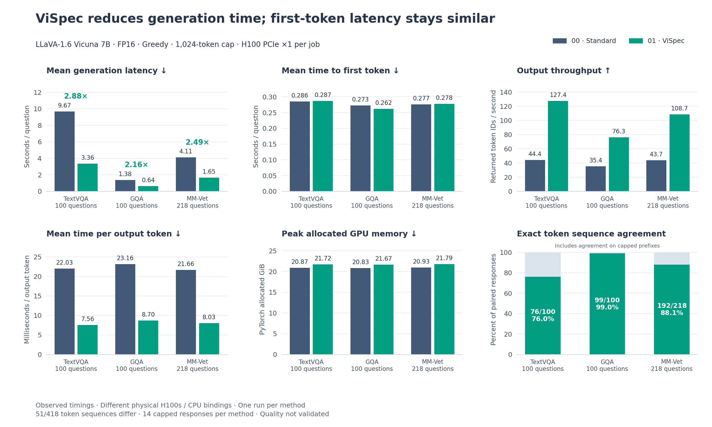
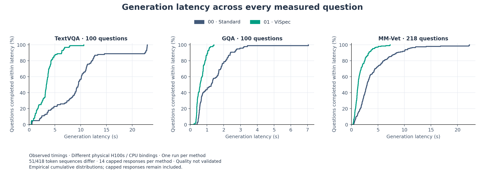

# Experiment comparison

These runs compare **00: standard autoregressive generation** with **01: ViSpec
speculative generation**, using the same LLaVA model and image questions. Standard
generation produces one token at a time. ViSpec proposes several with a smaller
model and checks them together. The goal is faster answers with preserved content
and correctness.

The tables use one value per cell, with separate rows for mean, median and p95.
Speedups describe observed timings. They have not been validated as speedups with
equivalent outputs.

## Benchmarks

- **TextVQA** tests reading text in images. We evaluated 100 questions per method.
- **GQA** tests visual reasoning. We evaluated 100 questions per method.
- **MM-Vet** tests broader, open-ended visual understanding. We evaluated 218 questions.

These results describe the evaluated subsets rather than full leaderboard scores.

## Plots and how to read them

Blue represents the standard method and green represents ViSpec. Each group
compares the same benchmark and question count. Bar charts start at zero, and
arrows indicate whether lower or higher values are generally preferable.

### Generation latency

Generation latency is the time needed to finish an answer, including initial
image/question processing and decoding. It is our main timing measure because
it captures the wait for a completed response. The observed speedup is **2.88×
for TextVQA, 2.16× for GQA and 2.49× for MM-Vet**. Lower latency is better when
the generated work is comparable. [Open the latency chart](plots/latest_greedy/latency.png).

### Time to first token (TTFT)

TTFT is the time until the first target-model token is ready. We measure it to
separate the initial wait from the time needed to finish an answer. It stays
roughly similar in these runs, so the observed benefit mainly comes after the
first token. This measures token availability rather than on-screen streaming.
[Open the TTFT chart](plots/latest_greedy/ttft.png).

### Output throughput

Throughput divides total returned token IDs by total generation seconds,
including special tokens such as EOS. It shows how much output the method
produces per second. We consider it alongside output length because shorter
answers alone can reduce latency. Higher is better for comparable responses.
[Open the throughput chart](plots/latest_greedy/throughput.png).

### Time per output token (TPOT)

TPOT estimates the average cost of continuing an answer after its first token.
We subtract TTFT from generation latency and divide by the remaining output-token
count. Lower values help explain the earlier completion despite similar initial
waits. The plot uses milliseconds and does not measure individual streamed-token
delays. [Open the TPOT chart](plots/latest_greedy/tpot.png).

### Peak allocated GPU memory

This is the highest live PyTorch GPU allocation after warmup, measured in GiB.
It shows whether faster generation requires more GPU capacity. ViSpec uses about
**0.85 GiB more** in these runs. The measurement excludes non-PyTorch memory and
model-loading peaks. [Open the memory chart](plots/latest_greedy/gpu_memory.png).

### Exact token sequence agreement

We compare paired output IDs through the first EOS, including EOS, to check
whether faster greedy decoding reproduces the baseline sequence. Agreement is
**367/418 (87.8%)** overall. Matching capped prefixes does not establish complete
answer equivalence, and matching outputs can still be wrong against ground truth.

### Latency distributions

The horizontal axis shows generation time in seconds. The vertical axis shows
the percentage of questions completed within that time. A curve farther left
indicates shorter response times. This view reveals typical and slow cases that
an average can hide.

These curves include capped responses and show variation across questions,
not uncertainty across independent runs. Both methods saved a response for every
question, but those responses can still be incomplete or incorrect. The
[plot guide](plots/README.md) records sources and reproduction commands.

## TextVQA

| Metric                                                  | 00 — Standard          | 01 — ViSpec                           |
| ------------------------------------------------------- | ---------------------- | ------------------------------------- |
| Completed questions                                     | 100/100                | 100/100                               |
| Mean generation latency (s)                             | 9.675                  | 3.365                                 |
| Median generation latency (s)                           | 9.528                  | 3.335                                 |
| p95 generation latency (s)                              | 22.805                 | 6.667                                 |
| Mean time to first token (s)                            | 0.286                  | 0.287                                 |
| Median time to first token (s)                          | 0.278                  | 0.279                                 |
| p95 time to first token (s)                             | 0.385                  | 0.388                                 |
| Mean recorded decode-loop time (s)¹                     | 9.389                  | 3.069                                 |
| Median recorded decode-loop time (s)¹                   | 9.208                  | 3.048                                 |
| p95 recorded decode-loop time (s)¹                      | 22.401                 | 6.353                                 |
| Mean time per output token (ms)                         | 22.028                 | 7.561                                 |
| Median time per output token (ms)                       | 21.952                 | 7.392                                 |
| p95 time per output token (ms)                          | 22.341                 | 9.498                                 |
| Mean returned output length (token IDs)                 | 429.300                | 428.680                               |
| Median returned output length (token IDs)               | 421.000                | 419.500                               |
| p95 returned output length (token IDs)                  | 1024.000               | 1024.000                              |
| Mean answer length (non-special tokens before EOS)      | 428.410                | 427.790                               |
| Median answer length (non-special tokens before EOS)    | 420.000                | 418.500                               |
| p95 answer length (non-special tokens before EOS)       | 1024.000               | 1024.000                              |
| Output throughput (tokens/s)                            | 44.37                  | 127.41                                |
| Observed latency speedup                                | 1.00× (reference)      | 2.88× (raw)                           |
| Mean accepted draft tokens per verification iteration   | N/A                    | 3.006                                 |
| Median accepted draft tokens per verification iteration | N/A                    | 4.000                                 |
| p95 accepted draft tokens per verification iteration    | N/A                    | 4.000                                 |
| Mean output tokens per verification iteration           | N/A                    | 4.006                                 |
| Median output tokens per verification iteration         | N/A                    | 5.000                                 |
| p95 output tokens per verification iteration            | N/A                    | 5.000                                 |
| EOS stops | 89 | 89 |
| Token-limit stops | 11 | 11 |
| Truncation rate                                         | 11.00%                 | 11.00%                                |
| Tokens returned after EOS                               | 0                      | 0                                     |
| Token-counter mismatches                                | 0/100 checked          | 0/100 checked                         |
| Peak PyTorch allocated memory (GiB)                     | 20.872                 | 21.721                                |
| Peak PyTorch reserved memory (GiB)                      | 24.709                 | 24.877                                |
| TextVQA consensus / score coverage                      | 0% / 100 scored        | 0% / 100 scored                       |
| Exact token sequence agreement                          | Reference              | 76/100 (76.00%)                       |
| Decoded answer agreement                                | Reference              | 76/100 (76.00%)                       |
| Quality change vs 00 (percentage points)                | Reference              | 0²                                    |
| Independent runs / repeat variation                     | 1 / pending            | 1 / pending                           |
| Greedy output equivalence                               | Reference              | Not validated: 24 differing sequences |
| Validated controlled speedup                            | Reference              | Pending                               |
| Runtime energy / GPU utilization                        | Not measured           | Not measured                          |

## GQA

| Metric                                                  | 00 — Standard          | 01 — ViSpec                          |
| ------------------------------------------------------- | ---------------------- | ------------------------------------ |
| Completed questions                                     | 100/100                | 100/100                              |
| Mean generation latency (s)                             | 1.380                  | 0.640                                |
| Median generation latency (s)                           | 1.251                  | 0.584                                |
| p95 generation latency (s)                              | 2.789                  | 1.112                                |
| Mean time to first token (s)                            | 0.273                  | 0.262                                |
| Median time to first token (s)                          | 0.262                  | 0.261                                |
| p95 time to first token (s)                             | 0.347                  | 0.313                                |
| Mean recorded decode-loop time (s)¹                     | 1.108                  | 0.369                                |
| Median recorded decode-loop time (s)¹                   | 0.976                  | 0.335                                |
| p95 recorded decode-loop time (s)¹                      | 2.489                  | 0.797                                |
| Mean time per output token (ms)                         | 23.155                 | 8.704                                |
| Median time per output token (ms)                       | 22.242                 | 7.992                                |
| p95 time per output token (ms)                          | 24.048                 | 11.815                               |
| Mean returned output length (token IDs)                 | 48.880                 | 48.850                               |
| Median returned output length (token IDs)               | 45.000                 | 45.000                               |
| p95 returned output length (token IDs)                  | 112.100                | 112.100                              |
| Mean answer length (non-special tokens before EOS)      | 47.880                 | 47.850                               |
| Median answer length (non-special tokens before EOS)    | 44.000                 | 44.000                               |
| p95 answer length (non-special tokens before EOS)       | 111.100                | 111.100                              |
| Output throughput (tokens/s)                            | 35.41                  | 76.33                                |
| Observed latency speedup                                | 1.00× (reference)      | 2.16× (raw)                          |
| Mean accepted draft tokens per verification iteration   | N/A                    | 2.859                                |
| Median accepted draft tokens per verification iteration | N/A                    | 3.000                                |
| p95 accepted draft tokens per verification iteration    | N/A                    | 4.000                                |
| Mean output tokens per verification iteration           | N/A                    | 3.859                                |
| Median output tokens per verification iteration         | N/A                    | 4.000                                |
| p95 output tokens per verification iteration            | N/A                    | 5.000                                |
| EOS stops | 100 | 100 |
| Token-limit stops | 0 | 0 |
| Truncation rate                                         | 0.00%                  | 0.00%                                |
| Tokens returned after EOS                               | 0                      | 0                                    |
| Token-counter mismatches                                | 0/100 checked          | 0/100 checked                        |
| Peak PyTorch allocated memory (GiB)                     | 20.828                 | 21.672                               |
| Peak PyTorch reserved memory (GiB)                      | 22.725                 | 22.893                               |
| GQA exact match / score coverage                        | 0% / 100 scored        | 0% / 100 scored                      |
| Exact token sequence agreement                          | Reference              | 99/100 (99.00%)                      |
| Decoded answer agreement                                | Reference              | 99/100 (99.00%)                      |
| Quality change vs 00 (percentage points)                | Reference              | 0²                                   |
| Independent runs / repeat variation                     | 1 / pending            | 1 / pending                          |
| Greedy output equivalence                               | Reference              | Not validated: 1 differing sequences |
| Validated controlled speedup                            | Reference              | Pending                              |
| Runtime energy / GPU utilization                        | Not measured           | Not measured                         |

## MM-Vet

| Metric                                                  | 00 — Standard             | 01 — ViSpec                           |
| ------------------------------------------------------- | ------------------------- | ------------------------------------- |
| Completed questions                                     | 218/218                   | 218/218                               |
| Mean generation latency (s)                             | 4.109                     | 1.651                                 |
| Median generation latency (s)                           | 2.941                     | 1.250                                 |
| p95 generation latency (s)                              | 10.614                    | 3.997                                 |
| Mean time to first token (s)                            | 0.277                     | 0.278                                 |
| Median time to first token (s)                          | 0.273                     | 0.275                                 |
| p95 time to first token (s)                             | 0.413                     | 0.414                                 |
| Mean recorded decode-loop time (s)¹                     | 3.832                     | 1.364                                 |
| Median recorded decode-loop time (s)¹                   | 2.661                     | 0.991                                 |
| p95 recorded decode-loop time (s)¹                      | 10.333                    | 3.692                                 |
| Mean time per output token (ms)                         | 21.659                    | 8.026                                 |
| Median time per output token (ms)                       | 21.550                    | 7.845                                 |
| p95 time per output token (ms)                          | 22.808                    | 10.178                                |
| Mean returned output length (token IDs)                 | 179.615                   | 179.413                               |
| Median returned output length (token IDs)               | 125.000                   | 126.000                               |
| p95 returned output length (token IDs)                  | 483.200                   | 489.150                               |
| Mean answer length (non-special tokens before EOS)      | 178.628                   | 178.427                               |
| Median answer length (non-special tokens before EOS)    | 124.000                   | 125.000                               |
| p95 answer length (non-special tokens before EOS)       | 482.200                   | 488.150                               |
| Output throughput (tokens/s)                            | 43.71                     | 108.69                                |
| Observed latency speedup                                | 1.00× (reference)         | 2.49× (raw)                           |
| Mean accepted draft tokens per verification iteration   | N/A                       | 2.829                                 |
| Median accepted draft tokens per verification iteration | N/A                       | 3.000                                 |
| p95 accepted draft tokens per verification iteration    | N/A                       | 4.000                                 |
| Mean output tokens per verification iteration           | N/A                       | 3.829                                 |
| Median output tokens per verification iteration         | N/A                       | 4.000                                 |
| p95 output tokens per verification iteration            | N/A                       | 5.000                                 |
| EOS stops | 215 | 215 |
| Token-limit stops | 3 | 3 |
| Truncation rate                                         | 1.38%                     | 1.38%                                 |
| Tokens returned after EOS                               | 0                         | 0                                     |
| Token-counter mismatches                                | 0/218 checked             | 0/218 checked                         |
| Peak PyTorch allocated memory (GiB)                     | 20.930                    | 21.785                                |
| Peak PyTorch reserved memory (GiB)                      | 30.959                    | 31.127                                |
| MM-Vet official judge / score coverage                  | Pending / 0 of 218 scored | Pending / 0 of 218 scored             |
| Exact token sequence agreement                          | Reference                 | 192/218 (88.07%)                      |
| Decoded answer agreement                                | Reference                 | 192/218 (88.07%)                      |
| Quality change vs 00 (percentage points)                | Reference                 | Pending                               |
| Independent runs / repeat variation                     | 1 / pending               | 1 / pending                           |
| Greedy output equivalence                               | Reference                 | Not validated: 26 differing sequences |
| Validated controlled speedup                            | Reference                 | Pending                               |
| Runtime energy / GPU utilization                        | Not measured              | Not measured                          |

## Overall suite

Each of the 418 turns contributes equally to the suite distributions. Throughput
divides total returned tokens by total generation time. Quality scores are not
pooled across benchmarks.

| Metric                                                  | 00 — Standard           | 01 — ViSpec                           |
| ------------------------------------------------------- | ----------------------- | ------------------------------------- |
| Completed questions                                     | 418/418                 | 418/418                               |
| Mean generation latency (s)                             | 4.788                   | 1.819                                 |
| Median generation latency (s)                           | 2.824                   | 1.172                                 |
| p95 generation latency (s)                              | 12.493                  | 4.770                                 |
| Mean time to first token (s)                            | 0.278                   | 0.276                                 |
| Median time to first token (s)                          | 0.273                   | 0.274                                 |
| p95 time to first token (s)                             | 0.412                   | 0.413                                 |
| Mean recorded decode-loop time (s)¹                     | 4.510                   | 1.534                                 |
| Median recorded decode-loop time (s)¹                   | 2.545                   | 0.904                                 |
| p95 recorded decode-loop time (s)¹                      | 12.243                  | 4.416                                 |
| Mean time per output token (ms)                         | 22.105                  | 8.077                                 |
| Median time per output token (ms)                       | 21.790                  | 7.661                                 |
| p95 time per output token (ms)                          | 23.681                  | 11.270                                |
| Mean returned output length (token IDs)                 | 208.072                 | 207.811                               |
| Median returned output length (token IDs)               | 117.500                 | 117.500                               |
| p95 returned output length (token IDs)                  | 559.150                 | 567.700                               |
| Mean answer length (non-special tokens before EOS)      | 207.105                 | 206.844                               |
| Median answer length (non-special tokens before EOS)    | 116.500                 | 116.500                               |
| p95 answer length (non-special tokens before EOS)       | 558.150                 | 566.700                               |
| Output throughput (tokens/s)                            | 43.46                   | 114.25                                |
| Observed latency speedup                                | 1.00× (reference)       | 2.63× (raw)                           |
| Mean accepted draft tokens per verification iteration   | N/A                     | 2.916                                 |
| Median accepted draft tokens per verification iteration | N/A                     | 3.000                                 |
| p95 accepted draft tokens per verification iteration    | N/A                     | 4.000                                 |
| Mean output tokens per verification iteration           | N/A                     | 3.916                                 |
| Median output tokens per verification iteration         | N/A                     | 4.000                                 |
| p95 output tokens per verification iteration            | N/A                     | 5.000                                 |
| EOS stops | 404 | 404 |
| Token-limit stops | 14 | 14 |
| Truncation rate                                         | 3.35%                   | 3.35%                                 |
| Tokens returned after EOS                               | 0                       | 0                                     |
| Token-counter mismatches                                | 0/418 checked           | 0/418 checked                         |
| Exact token sequence agreement                          | Reference               | 367/418 (87.80%)                      |
| Decoded answer agreement                                | Reference               | 367/418 (87.80%)                      |
| Independent runs / repeat variation                     | 1 / pending             | 1 / pending                           |
| Greedy output equivalence                               | Reference               | Not validated: 51 differing sequences |
| Validated controlled speedup                            | Reference               | Pending                               |

## Shared settings and evidence

Both runs used **LLaVA-1.6 Vicuna 7B, FP16 (16-bit floating point), greedy decoding
at temperature 0.0**, and a cap of **1,024 returned token IDs including EOS**.
ViSpec used depth 3, top-k 8, a tree budget of 30 and 2 query vectors. Both launch
trees were clean at commit `771911bd8665846e9ab8cb698cb22c2929d296b5`.

Each job received **one H100 PCIe with 79.2 GiB visible VRAM, 8 logical CPUs and
64 GiB RAM**. The jobs overlapped on `evc46`, using different physical GPUs and
CPU bindings. Their hardware evidence is recorded separately:

- **00, job 950793** used GPU `c8aca2f5-7741-b9ef-76aa-48901fe44401`.
  See its [device report](00_baseline_original/runs/20261017T211853Z_771911bd8665_9RRsjY/device.txt)
  and [recorded metrics](00_baseline_original/runs/20261017T211853Z_771911bd8665_9RRsjY/reports/20261017T220622Z_df807dd5/summary.md).
- **01, job 950803** used GPU `cd5e5946-fc28-f3cf-978d-635f8e613aa4`.
  See its [device report](01_baseline_draft/runs/20261017T211906Z_771911bd8665_ei1koG/device.txt)
  and [recorded metrics](01_baseline_draft/runs/20261017T211906Z_771911bd8665_ei1koG/reports/20261017T214508Z_37fa2d97/summary.md).

## Reading the table statistics

The **mean** is the average, the **median** is the middle measurement, and
**p95** is a threshold covering about 95% of measurements. Generation latency
includes prefill and decoding but excludes loading, prompt preparation, text
conversion and scoring. Throughput is total returned IDs divided by total
generation seconds. TPOT is `(latency − TTFT) / (output IDs − 1)` for outputs
longer than one token.

Memory values are post-warmup PyTorch allocator peaks per GPU. They are not host
totals or whole-process VRAM. Launch-time device snapshots do not measure runtime
energy or utilization. The [metric guide](METRICS.md#what-each-metric-means)
explains every table field and its purpose.

## Limits on interpretation

The timing benefit is promising, but several conditions prevent a validated
claim of faster generation with equivalent outputs:

- **Outputs differ.** There are 51 mismatching token sequences, and agreement on
  capped prefixes is not full-answer equivalence. Decoded agreement uses exact
  answer text here, with the same counts when whitespace differences are ignored.
- **Some responses are capped.** The output limit stopped 14 answers per method.
- **Hardware bindings differ.** The methods ran on different physical GPUs and
  CPU bindings, with one independent run per method.
- **Quality remains unresolved.** Equal zero strict scores do not establish
  preserved quality. Semantic grading is unfinished, and official MM-Vet judging
  remains pending.

**¹ Decode-loop time** covers different work: the autoregressive loop in 00 and
verification after initial drafting in 01. Use total generation latency for
cross-method speed claims.

**² Quality change** uses the recorded strict benchmark scores. Verbose answers
can fail matching even when they contain a correct short answer. These scores
exclude the unfinished semantic review.

The [detailed review](01_baseline_draft/RESULTS_20261017.md) preserves artifact
verification and every first token mismatch.
